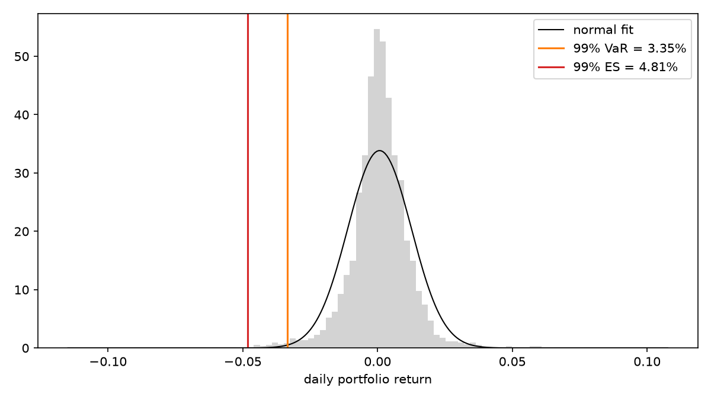
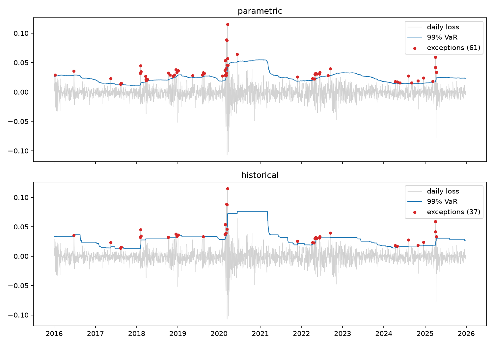

# Value at Risk and Expected Shortfall with backtesting

How much can a stock portfolio lose in one day? This project computes **Value at Risk (VaR)**
and **Expected Shortfall (ES)** of an equal-weighted portfolio of 5 US stocks
(AAPL, MSFT, JPM, XOM, JNJ, daily data 2015-2025) with three methods, and then **backtests**
them: on how many days did the real loss exceed the VaR, and is that number acceptable?

- **VaR (99%)**: the loss that should only be exceeded on 1% of the days.
- **ES (99%)**: the average loss on those worst 1% of days.

## Methods

| Method | Idea |
|---|---|
| Historical | Take the percentile of past returns. No assumption about the distribution. |
| Parametric | Assume normal returns; VaR and ES come from the mean and standard deviation. |
| Monte Carlo | Simulate 100 000 days from a multivariate normal with the sample mean and covariance of the 5 stocks. |

Note: with normal returns, Monte Carlo and parametric are the same model, so they give
practically the same answer (the simulation is only a way of computing it). It becomes
useful when the simulated distribution is not normal.

## Results

One-day risk of the portfolio, using the full sample:

| Method | 95% VaR | 95% ES | 99% VaR | 99% ES |
|---|---|---|---|---|
| Historical | 1.66% | 2.77% | 3.35% | 4.81% |
| Parametric | 1.86% | 2.36% | 2.67% | 3.07% |
| Monte Carlo | 1.85% | 2.34% | 2.69% | 3.09% |

The normal model **underestimates tail risk**: at 99% its ES is 3.1% against 4.8% in the
real data, because real returns have fat tails.



**Backtest** (rolling window of 250 days, 2 514 test days). The Kupiec test checks whether
the number of exceptions is compatible with the expected 1% or 5%
(p-value below 0.05 means the model is rejected):

| Method | Confidence | Exceptions | Expected | Kupiec p-value |
|---|---|---|---|---|
| Historical | 95% | 131 | 125.7 | 0.630 |
| Parametric | 95% | 123 | 125.7 | 0.804 |
| Monte Carlo | 95% | 124 | 125.7 | 0.876 |
| Historical | 99% | 37 | 25.1 | 0.026 (rejected) |
| Parametric | 99% | 61 | 25.1 | < 0.001 (rejected) |
| Monte Carlo | 99% | 62 | 25.1 | < 0.001 (rejected) |

At 95% all three models pass. At 99% the normal-based models have **2.4 times more
exceptions than expected**, and the historical one is also rejected, though less strongly.



**Basel traffic light** (99% VaR, exceptions in 250 days: green 0-4, yellow 5-9, red 10 or more):

| Method | Last 250 days (2025) | 250 days from 2020-01-01 (COVID crash) |
|---|---|---|
| Historical | 3, green | 7, yellow |
| Parametric | 4, green | 14, **red** |
| Monte Carlo | 4, green | 14, **red** |

In calm periods all models look fine; in the 2020 crash the normal-based models fail
exactly when risk matters most.

## Tests

`pytest` checks: the historical VaR on a known array, the parametric VaR against the normal
formula, that the three methods agree on normal data, the Kupiec test on cases with a
known answer, the Basel zones, and that the backtest of a normal model on normal data gives
about 1% of exceptions.

## How to run

```bash
git clone https://github.com/tomiaubin/var-backtesting.git
cd var-backtesting
pip install -r requirements.txt
pytest
python var.py     # prints the tables above and saves the figures
```

The prices are saved in `data/prices.csv`, so it works without internet. If the file is
deleted, they are downloaded again from Yahoo Finance with `yfinance`.

## Limitations and next steps

- Only 5 large US stocks that did well in this period (survivorship bias); one currency; no derivatives.
- Fat tails: replacing the normal by a Student-t distribution, or using EWMA volatility, should improve the 99% results.
- The Kupiec test only counts exceptions; the Christoffersen test would also check if they come in clusters.

## Files

- `var.py`: data loading, three VaR/ES methods, backtest, Kupiec test, Basel zones and figures.
- `test_var.py`: tests.
- `data/prices.csv`: adjusted closing prices.

## Author

Tomás Aubin, Physics undergraduate at UBA.
